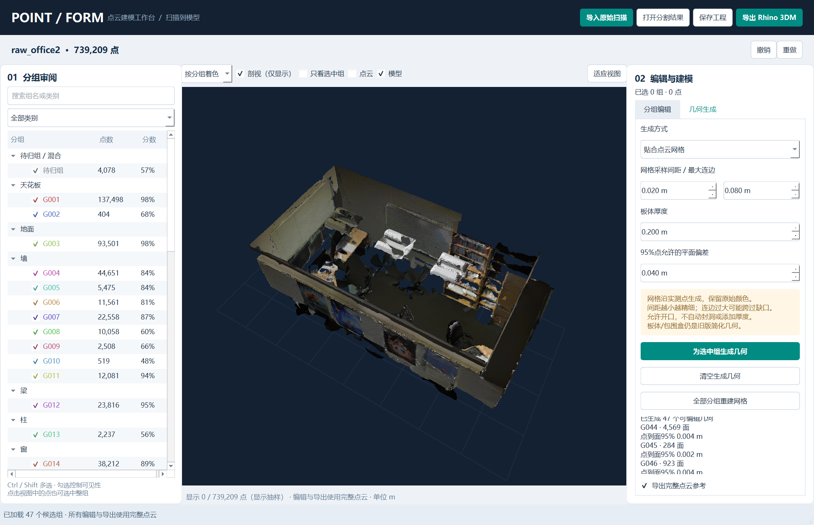

# PointCloud to Rhino · 建筑点云分割与网格重建

把彩色室内扫描点云转换为可审阅的语义分组，并生成能在 Rhino 中继续编辑的网格。

面向建筑扫描与建模的点云处理工具。作者：樊奕翔。



## Windows 客户端下载

**[下载 Windows 64 位完整客户端（约 409 MB）](https://github.com/fangod6767/pointcloud-to-rhino/releases/download/v0.4.0/PointCloudDesk-Windows-x64.zip)** · [版本说明与校验文件](https://github.com/fangod6767/pointcloud-to-rhino/releases/tag/v0.4.0)

1. 下载 `PointCloudDesk-Windows-x64.zip`，将整个压缩包解压。
2. 打开解压后的 `PointCloudDesk` 文件夹，双击 `PointCloudDesk.exe`。
3. 保留旁边的 `_internal`、`engine` 和 `THIRD_PARTY` 文件夹，不要只复制 EXE。

完整包包含运行环境、CPU 分割引擎和预训练权重，**无需安装 Python 或另行下载权重**。打开后即可导入自己的彩色室内点云。处理在本机执行，查看与继续编辑 3DM 可使用 Rhino 8。尚未在所有 Windows 设备上验证。

GitHub 自动生成的 `Source code (zip)` 是源码包；直接使用软件请下载上面的客户端压缩包。

## 工作流程

**彩色点云 → RandLA-Net 语义分割 → RANSAC 平面提取 + DBSCAN 空间聚类 → 人工审阅 → 贴合点云的网格 → 3DM**

- 独立桌面窗口，支持导入扫描点云、查看语义与候选组、调整分组和导出模型。
- 13 类室内语义，包括墙、地板、天花、门、窗、桌椅等。
- Ball Pivoting 生成贴合实测点的网格，3DM 图层包含物体类别和组号。
- 随机森林是单独训练的对照基线，不参与客户端主流程。
- 提供可复现的分割、基线评估和网格质量检查流程。

输出是 **Mesh**，不保证封闭，也不是自动生成的 BIM 或 NURBS 实体。几何分组是候选组，仍需人工判断。该预训练模型面向室内 S3DIS 数据；室外、无颜色或不同扫描条件下的质量需要重新验证。

## 从源码安装与启动（Windows）

本项目原环境使用 Python 3.12。以下命令在仓库根目录的 PowerShell 中执行：

```powershell
py -3.12 -m venv .venv
.\.venv\Scripts\python.exe -m pip install --upgrade pip
.\.venv\Scripts\python.exe -m pip install -r requirements.txt
.\.venv\Scripts\python.exe download_weights.py
.\.venv\Scripts\python.exe pointcloud_client/app.py
```

依赖较大，首次安装需要联网。版本清单来自原项目环境；本次发布检查复用了该环境，尚未在全新机器上验证安装。默认客户端使用 CPU 推理，不强制要求独立显卡。源码启动不需要安装 Rhino；查看、继续编辑导出的 3DM 可使用 Rhino。

在窗口中导入彩色 PCD/PLY 等扫描文件，确认单位换算与竖直轴，运行分割与建模，审阅候选组后导出 3DM。可调整网格采样间距和最大连边长度。没有 RGB 时的中性颜色回退未经准确率验证。

## 示例数据与命令行处理

下载一个真实 S3DIS 房间并执行分割与评估：

```powershell
.\.venv\Scripts\python.exe prepare_demo.py
```

脚本会下载权重及 `Area_3/office_2` 房间，执行 CPU 推理，并将预测保存到 `results/area3_batch/Area_3_office_2/`。在客户端中选择“打开分割结果”，载入其中的 `segmentation.npz`，即可审阅候选组、重建网格并导出 3DM。

该步骤可能需要数分钟或更久。运行前请阅读下方数据来源及使用条款。已有输出时脚本会停止，避免覆盖实验。镜像若不再支持 Range 请求，需从原始来源取得数据。

也可以直接处理自己的彩色点云：

```powershell
.\.venv\Scripts\python.exe segmentation_pipeline.py scan.ply --output results/my_scan --device cpu --max-passes 300
```

默认单位为米、Z 轴向上；可通过 `--scale-to-meters` 和 `--up-axis` 调整。输出包含语义标签、置信度、几何候选组及彩色 PLY。使用自己的扫描时，没有真实标签便不能计算准确率；只有输入带 `semantic` 真实标签的 NPZ 时，才可添加 `--evaluate`。

## 实验结果与边界

| 历史实验 | 测试范围 | OA | mIoU |
|---|---|---:|---:|
| 随机森林 | Area 3 / office_1 | 48.31% | 29.95% |
| 预训练 RandLA-Net | Area 3 / office_1 | 93.24% | 81.37% |
| 预训练 RandLA-Net 固定批次 | Area 3 全部 23 个房间 | 87.61% | 70.20% |

随机森林只在 Area 1 / office_1 训练，RandLA-Net 使用外部预训练权重，**未在本项目训练或微调**。两者训练数据规模不同，因此不能把差异完全归因于算法结构。本项目不是完整六折交叉验证，也未独立审计权重的全部上游训练过程。

表中结果来自已保存的历史流程；客户端加入局部坐标原点处理后，体素划分与结果可能变化，不能把这些成绩直接作为当前客户端的准确率保证。原始统计报告保存在 [docs/evidence](docs/evidence)。

## 数据、权重与引用

- S3DIS：Armeni 等，*3D Semantic Parsing of Large-Scale Indoor Spaces*, CVPR 2016。[原项目与数据入口](http://buildingparser.stanford.edu/dataset.html)。下载工具使用 [第三方镜像](https://huggingface.co/datasets/cminst/S3DIS)，镜像标签不能替代原始数据条款。
- Hu 等，*RandLA-Net: Efficient Semantic Segmentation of Large-Scale Point Clouds*, CVPR 2020。[论文](https://arxiv.org/abs/1911.11236)。
- 网络实现改编自 [Open3D-ML](https://github.com/isl-org/Open3D-ML)，保留其 [MIT 声明](vendor/open3d_ml/LICENSE)。固定上游提交、权重来源与 SHA-256 见 [weights/provenance.json](weights/provenance.json)。
- `download_weights.py` 下载约 60 MB 的官方发布权重并校验 SHA-256；权重不存入 Git。

Git 源码仓库不附完整数据集、原始点云样本、模型权重、安装环境、打包 EXE 或历史 3DM；Releases 中的完整客户端另附运行环境和预训练权重，并保留第三方许可与出处。使用者自行取得点云数据并遵守各自条款。本仓库目前未对原创代码声明统一开源许可证；公开展示不改变第三方文件已有许可。

## 文件入口与验证

| 文件 | 用途 |
|---|---|
| `prepare_demo.py` | 下载示例房间并执行分割评估 |
| `segmentation_pipeline.py` | 点云预处理、模型推理、语义输出 |
| `randlanet_portable.py` | 适配后的 RandLA-Net 网络 |
| `semantic_groups.py` | 语义内 RANSAC / DBSCAN 分组 |
| `comparison_baseline.py` | 随机森林训练与评估 |
| `pointcloud_client/app.py` | 桌面客户端 |
| `pointcloud_client/mesh_reconstruction.py` | 网格重建 |
| `pointcloud_client/exporter.py` | 带中文类别图层的 3DM 导出 |

无需真实数据的读取与网格测试：

```powershell
.\.venv\Scripts\python.exe -m unittest discover -s pointcloud_client -p test_scan.py -v
.\.venv\Scripts\python.exe -m unittest discover -s pointcloud_client -p test_mesh.py -v
```

其他测试包含对本地真实样例、GUI 或历史成果的依赖，不能在缺少这些文件时直接当作通用测试套件运行。

